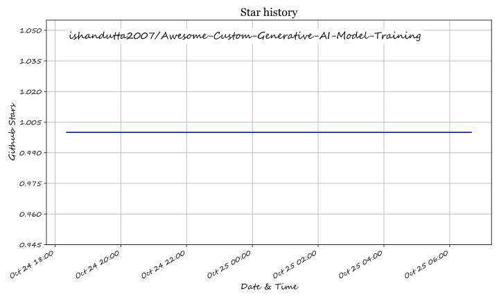

# Awesome-Custom-Generative-AI-Model-Training

# Awesome-Custom-Generative-AI-Model-Training

## Top Custom Generative AI Model Training

**Curated List of SaaS Products & Open-Source GitHub Projects**

*Focused on Fine-Tuning, Custom Training, LoRA/QLoRA, DreamBooth, Diffusion & LLM Adaptation*

**Last updated: October 2026**

This repository tracks notable **SaaS platforms** and **open-source projects** for **Custom Generative AI Model Training**. These products and tools help teams fine-tune image, video, and language models on proprietary data for brand-specific styles, subjects, domain adaptation, and controlled generation.

**Examples** include Adobe Firefly Custom Models, Scenario, Photoroom API, Segmind, Bria AI, Asteroid AI, OctoAI, Stability AI Fine-Tuning, LeMur AI, and Fal.ai Training (the category leaders).

**Open-source emphasis**: Custom generative model training has one of the richest open ecosystems in AI. **LLaMA-Factory**, **Unsloth**, **Axolotl**, **Hugging Face PEFT/TRL/Diffusers**, **Kohya_ss**, and related projects enable fully transparent, self-hosted, and highly efficient fine-tuning. This section is heavily expanded.

Contributions welcome! Open a PR to add/update entries. Keep descriptions factual and link to official sites.

## Table of Contents

- [SaaS/Hosted Platforms](#saas-hosted-platforms)

- [Open-Source GitHub Projects](#open-source-github-projects)

- [How to Contribute](#how-to-contribute)

- [Disclaimer](#disclaimer)

## SaaS/Hosted Platforms

- **[Adobe Firefly Custom Models](https://www.adobe.com/products/firefly.html)**  

  Enterprise custom model training on Adobe Firefly for brand-safe, style-consistent image generation integrated with Creative Cloud workflows.

- **[Scenario](https://www.scenario.com/)**  

  Platform focused on training custom AI models for game assets, characters, and stylized content with strong creative tooling.

- **[Photoroom API](https://www.photoroom.com/api)**  

  API-first background removal and generative editing with custom model capabilities for product and e-commerce imagery.

- **[Segmind](https://www.segmind.com/)**  

  Serverless platform for running and fine-tuning open generative models with easy APIs and serverless infrastructure.

- **[Bria AI](https://bria.ai/)**  

  Responsible generative AI platform offering custom model training and licensed data for commercial image generation.

- **[Asteroid AI](https://asteroid.ai/)**  

  Specialized platform for training and deploying custom generative models with focus on controllable and high-quality outputs.

- **[OctoAI](https://octo.ai/)**  

  Infrastructure and fine-tuning services for running and customizing open generative models at scale.

- **[Stability AI Fine-Tuning](https://stability.ai/)**  

  Official fine-tuning and customization options around Stable Diffusion and related models from the Stability ecosystem.

- **[LeMur AI](https://lemur.ai/)**  

  Platform for custom generative model training and deployment tailored to creative and enterprise use cases.

- **[Fal.ai Training](https://fal.ai/)**  

  Fast, developer-friendly platform for fine-tuning and serving generative models with simple APIs and competitive pricing.

## Open-Source GitHub Projects

- **[LLaMA-Factory](https://github.com/hiyouga/LLaMA-Factory)**  

  Unified fine-tuning framework supporting 100+ LLMs and VLMs. Offers full fine-tuning, LoRA, QLoRA, DPO, PPO, KTO, ORPO and a user-friendly Web UI (LLaMA Board).

- **[Unsloth](https://github.com/unslothai/unsloth)**  

  Extremely memory-efficient and fast fine-tuning library. Delivers major VRAM savings and speedups for LoRA/QLoRA and reinforcement learning on consumer and pro GPUs.

- **[Axolotl](https://github.com/axolotl-ai-cloud/axolotl)**  

  Production-oriented, YAML-driven fine-tuning framework. Excellent multi-GPU support, DeepSpeed/FSDP integration, and reproducible configs for SFT, DPO, and advanced alignment methods.

- **[Hugging Face PEFT](https://github.com/huggingface/peft)**  

  Parameter-Efficient Fine-Tuning library (LoRA, QLoRA, Prefix Tuning, etc.). The foundational building block used by almost every modern open fine-tuning stack.

- **[Hugging Face TRL](https://github.com/huggingface/trl)**  

  Transformer Reinforcement Learning library providing SFT, DPO, PPO, GRPO, and reward modeling trainers tightly integrated with Transformers and PEFT.

- **[Diffusers + Finetrainers](https://github.com/huggingface/diffusers)**  

  Official Hugging Face diffusion training scripts and the Finetrainers project for scalable, memory-optimized training of image and video diffusion models (DreamBooth, LoRA, ControlNet, etc.).

- **[Kohya_ss](https://github.com/bmaltais/kohya_ss)**  

  Popular and mature GUI + scripts for fine-tuning Stable Diffusion models (LoRA, DreamBooth, textual inversion, and advanced techniques). Widely used in the image generation community.

- **[DeepSpeed](https://github.com/microsoft/DeepSpeed)**  

  Microsoft’s distributed training and optimization library. Powers efficient multi-GPU and multi-node fine-tuning of large models across many open frameworks.

- **[Accelerate](https://github.com/huggingface/accelerate)**  

  Hugging Face library that simplifies distributed training, mixed precision, and multi-GPU setups for both language and diffusion models.

- **[SimpleTuner / Community SD Trainers](https://github.com/bghira/SimpleTuner)**  

  Modern open-source training tools focused on high-quality Stable Diffusion and diffusion model fine-tuning with advanced features and ease of use.

### Additional Strong Open-Source Options

- LLM fine-tuning leaders: **LLaMA-Factory**, **Unsloth**, **Axolotl**.

- Core libraries: **PEFT** + **TRL** + **Transformers** + **Accelerate**.

- Diffusion / image model training: **Diffusers**, **Kohya_ss**, **Finetrainers**, SimpleTuner.

- Distributed & large-scale: **DeepSpeed**, FSDP, Megatron-LM integrations.

- Accepting that commercial platforms (Adobe Firefly Custom Models, Fal.ai, Segmind, Bria, Stability, Scenario) still lead in managed infrastructure, brand-safe data, easy APIs, and enterprise support.

**Frameworks for building custom systems**:  

For LLMs → start with **Unsloth** (single GPU) or **Axolotl** / **LLaMA-Factory** (multi-GPU + advanced methods).  

For images/video → use **Kohya_ss** or **Diffusers** training scripts + **PEFT**.  

Combine with **DeepSpeed** and **Accelerate** for scale. Ideal for teams that want full ownership of weights, data, and training code without vendor lock-in.

## How to Contribute

1. Fork the repo.

2. Add/edit entries in `README.md` (follow existing format).

3. Include: name, link, 1–2 sentence description, and whether it's SaaS or open-source.

4. Submit PR with a short explanation.

Star the repo if you find it useful!

## Disclaimer

- This is a **community-curated** list — not exhaustive and not an endorsement.

- Fine-tuning generative models involves significant compute, data rights, and potential copyright or safety considerations. Always review model licenses, dataset provenance, and applicable regulations. Self-hosted open-source tools give maximum control but require technical expertise. This list is not legal or security advice.

---

**Made for AI engineers, creative technologists, researchers, and open-source advocates.**

Let's keep custom generative AI training powerful, transparent, and as open as practical.

## ⭐ Star History

<a href="https://star-history.com/#ishandutta2007/Awesome-Custom-Generative-AI-Model-Training&Timeline" align="center">
  <picture>
    <source media="(prefers-color-scheme: dark)" srcset="assets/ishandutta2007_Awesome-Custom-Generative-AI-Model-Training_growth.svg">
    
  </picture>
</a>
