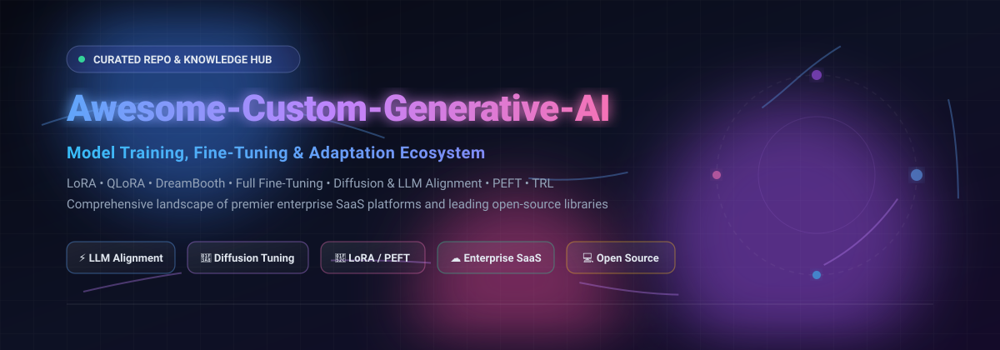

# 🚀 Awesome-Custom-Generative-AI-Model-Training

  

  
  
  
  
  
  

---

## 🌟 Top Custom Generative AI Model Training & Fine-Tuning Ecosystem

> **A Curated, SEO-Optimized Guide to Enterprise SaaS Platforms and Open-Source GitHub Repositories for Fine-Tuning, LoRA/QLoRA, DreamBooth, Diffusion Adaptation, and LLM Post-Training.**

📅 **Last updated: October 2026**

Welcome to the definitive directory for **Custom Generative AI Model Training**. In modern artificial intelligence engineering, off-the-shelf foundation models rarely satisfy enterprise-grade requirements for domain knowledge, strict brand consistency, style adherence, safety guardrails, and deterministic outputs. This repository tracks both the premier **commercial SaaS infrastructure** and cutting-edge **open-source libraries** enabling organizations to fine-tune image, video, multi-modal, and large language models (LLMs) on private datasets.

Whether you are implementing parameter-efficient fine-tuning (PEFT/LoRA), direct preference optimization (DPO/RLHF), full parameter training, or specialized diffusion style transfer, this curated guide provides actionable insights into market dynamics, pricing, free tiers, and GitHub stars.

---

## 📑 Table of Contents

- [📊 Sector Overview & Market Dynamics](#-sector-overview--market-dynamics)
- [☁️ SaaS & Hosted Fine-Tuning Platforms](#️-saas--hosted-fine-tuning-platforms)
- [💻 Open-Source GitHub Projects](#-open-source-github-projects)
- [💡 Choosing the Right Training Architecture](#-choosing-the-right-training-architecture)
- [🤝 How to Contribute](#-how-to-contribute)
- [💖 Support & Sponsorship](#-support--sponsorship)
- [📈 Star History](#-star-history)
- [⚖️ Disclaimer](#️-disclaimer)

---

## 📊 Sector Overview & Market Dynamics

The custom generative AI model training and fine-tuning market is currently estimated at **~$3.1B to $3.8B** (within the broader ~$60B+ generative AI industry), projected to surpass **$20B by the early 2030s** at an annual growth rate exceeding 30%. 

While upstream computing infrastructure and foundation model weights remain heavily concentrated among a handful of tech giants and frontier labs (winner-takes-most dynamics), the downstream fine-tuning, domain adaptation, and specialized training SaaS layer is **highly fragmented and rapidly expanding** with specialized vertical tooling. Organizations prioritize sovereign weight ownership, custom adapters, and private data boundaries over monolithic generic models.

---

## ☁️ SaaS & Hosted Fine-Tuning Platforms

The following SaaS platforms provide managed compute, zero-setup training pipelines, dataset curation workflows, and commercial API serving. Products are sorted in **descending order by company size** (market capitalization, recent valuation, and ARR).

| 🏢 Platform | 📝 Description | 📊 Size (Valuation / Revenue) | 🏷️ Starting Tier Pricing | 🎁 Free Tier Limits |
| :--- | :--- | :--- | :--- | :--- |
| **[Adobe Firefly Custom Models](https://www.adobe.com/products/firefly.html)** | Enterprise custom model training on Adobe Firefly for brand-safe, style-consistent image generation integrated with Creative Cloud workflows. | Market Cap: ~$100B / ARR: ~$25B | $9.99/mo (Firefly Standard plan with 2,000 monthly generative credits) | Free plan includes 25 monthly generative credits (or daily curated model generations) |
| **[fal.ai Training](https://fal.ai/)** | Fast, developer-friendly platform for fine-tuning and serving generative models with simple APIs and competitive pricing. | Valuation: $4.5B (Series D) / ARR: ~$200M | Pay-as-you-go starting at ~$0.001/sec compute; Starter subscription tier at $50/mo | Free browser sandbox testing; promotional startup/research grants from $1,000 to $5,000 in credits upon application |
| **[Stability AI Fine-Tuning](https://stability.ai/)** | Official fine-tuning and customization options around Stable Diffusion and related models from the Stability ecosystem. | Valuation: ~$1.0B - $1.8B / ARR: ~$190M | Starting credit top-up pack at $10.00; Commercial Creator tiers from $20/mo | Free for non-commercial & personal research (<$1M annual revenue); 25 free API credits (~$0.25) on signup |
| **[AssemblyAI (LeMur AI)](https://lemur.ai/)** | Platform for custom generative model processing and LLM reasoning directly on speech/audio transcripts tailored to enterprise workflows. | Valuation: ~$600M (Series C) / ARR: ~$30M+ | Pay-as-you-go starting at $0.0003/token for LLM reasoning ($0.15/hr audio transcription) | $50 in free credit allowance upon signup without credit card |
| **[Photoroom API](https://www.photoroom.com/api)** | API-first background removal and generative editing with custom model capabilities for product and e-commerce imagery. | Valuation: $500M (Series B) / ARR: ~$50M - $94M | $20/mo (Basic plan starting quota of 1,000 image edits) | Free Sandbox mode with watermarked outputs; up to 60,000 free images for early startups via Startup Plan |
| **[OctoAI](https://octo.ai/)** | Infrastructure and fine-tuning services for running and customizing open generative models at scale (acquired by NVIDIA). | Valuation: $250M (Acquired by NVIDIA) / ARR: ~$5M | Integrated into NVIDIA NIM microservices; historical standalone pay-as-you-go started at $10 top-up | Historical $10 developer trial credits; free prototyping available via NVIDIA NIM (build.nvidia.com) |
| **[Bria AI](https://bria.ai/)** | Responsible generative AI platform offering custom model training and licensed data for commercial image generation. | Valuation: ~$150M - $250M (Series B) / ARR: ~$10M | Pay-as-you-go starting at $0.08 per image action / startup tier at $700/mo | 1,000 free API calls / actions on developer signup without credit card |
| **[Scenario](https://www.scenario.com/)** | Platform focused on training custom AI models for game assets, characters, and stylized content with strong creative tooling. | Valuation: ~$30M - $50M (Total funding: $6M) | $15/mo (Starter plan with 1,500 compute units) | 50 daily compute credits for personal evaluation use (non-commercial, standard queue) |
| **[Asteroid AI](https://asteroid.ai/)** | Specialized platform for training and deploying custom generative models and browser/desktop AI workflows. | Valuation: ~$10M - $20M (Seed / YC W25, Total funding: ~$750K) | $300/mo (Startup tier with $330 in credits, BAA, and 25 concurrent environments) | Self-serve free plan with Astro workflow builder access and pay-as-you-go sandbox |
| **[Segmind](https://www.segmind.com/)** | Serverless platform for running and fine-tuning open generative models with easy APIs and serverless infrastructure. | Valuation: ~$5M - $10M (Total funding: $1.16M) | Pay-as-you-go starting at $10.00 minimum credit top-up (~$0.0003/sec compute) | Flexible Free plan includes starting credits upon signup to prototype workflows |

---

## 💻 Open-Source GitHub Projects

Open-source fine-tuning gives developers full ownership over weights, datasets, and hyperparameters without vendor lock-in. Below are the leading open-source libraries and frameworks, **sorted in descending order by GitHub stargazers**. Each repository includes a clickable star badge linking directly to its stargazers page.

1. **[Hugging Face Transformers](https://github.com/huggingface/transformers)**   
   The foundational machine learning library providing state-of-the-art implementations of tens of thousands of pretrained models for text, vision, and audio, complete with native PyTorch `Trainer` fine-tuning APIs.

2. **[Unsloth](https://github.com/unslothai/unsloth)**   
   Ultra-fast, memory-efficient fine-tuning framework delivering 2x to 5x speedups and 70% to 80% VRAM memory reduction for LoRA, QLoRA, and RL methods on single-GPU workstations and consumer graphics cards.

3. **[LLaMA-Factory](https://github.com/hiyouga/LLaMA-Factory)**   
   Unified, modular fine-tuning suite supporting 100+ LLMs and VLMs. Supports full parameter fine-tuning, LoRA, QLoRA, GaLore, Badam, DPO, PPO, KTO, and ORPO, bundled with the no-code `LLaMA Board` Web UI.

4. **[DeepSpeed](https://github.com/microsoft/DeepSpeed)**   
   Microsoft's high-performance deep learning optimization library featuring ZeRO (Zero Redundancy Optimizer), 3D parallelism, and MoE training optimizations powering massive distributed training and fine-tuning.

5. **[Colossal-AI](https://github.com/hpcaitech/ColossalAI)**   
   Unified deep learning system for large AI models with automated multidimensional parallelism, efficient memory offloading, and low-cost fine-tuning workflows for multi-billion parameter models.

6. **[FastChat](https://github.com/lm-sys/FastChat)**   
   Open platform for training, serving, and evaluating LLM-based chatbots and multi-turn conversational agents, famously powering the LMSYS Chatbot Arena and standard Vicuna fine-tuning pipelines.

7. **[Diffusers + Finetrainers](https://github.com/huggingface/diffusers)**   
   The de facto standard library for state-of-the-art diffusion models across image, audio, and video modalities. Features production-ready training scripts for DreamBooth, LoRA, ControlNet, Flux, and SDXL.

8. **[FlashAttention](https://github.com/Dao-AILab/flash-attention)**   
   Fast and memory-efficient exact attention algorithm with IO-awareness, serving as the essential underlying hardware accelerator layer across virtually every modern transformer fine-tuning framework.

9. **[Hugging Face PEFT](https://github.com/huggingface/peft)**   
   Parameter-Efficient Fine-Tuning library supporting LoRA, QLoRA, Prefix Tuning, P-Tuning, IA3, and AdaLoRA. Seamlessly integrates with PyTorch and Transformers to train massive models on minimal VRAM.

10. **[Hugging Face TRL](https://github.com/huggingface/trl)**   
    Transformer Reinforcement Learning library providing tools for full post-training: Supervised Fine-Tuning (SFT), Reward Modeling, Direct Preference Optimization (DPO), PPO, and Group Relative Policy Optimization (GRPO).

11. **[Megatron-LM](https://github.com/NVIDIA/Megatron-LM)**   
    NVIDIA's research framework for training transformer language models at scale using tensor, pipeline, sequence, and expert parallelism across massive supercomputing clusters.

12. **[LitGPT](https://github.com/Lightning-AI/litgpt)**   
    Hackable, 100% clean-room CLI and Python library from Lightning AI for pretraining, fine-tuning (LoRA, QLoRA, full), and deploying 20+ open LLMs without deep dependency chains.

13. **[Kohya_ss GUI](https://github.com/bmaltais/kohya_ss)**   
    The industry-standard GUI and training suite for fine-tuning Stable Diffusion, SDXL, and Flux models via LoRA, LyCORIS, DreamBooth, and textual inversion for visual artists and creative teams.

14. **[Axolotl](https://github.com/axolotl-ai-cloud/axolotl)**   
    Production-grade, YAML-configured fine-tuning harness for LLMs. Offers multi-GPU DeepSpeed/FSDP recipes, sample-packing, multipack dataset loaders, and reproducible pipelines for SFT and DPO.

15. **[Hugging Face Accelerate](https://github.com/huggingface/accelerate)**   
    Streamlined orchestration library that allows standard PyTorch code to run across multi-GPU, multi-node, mixed precision (fp16, bf16, fp8), and DeepSpeed/FSDP with zero code rewrites.

16. **[Torchtune](https://github.com/pytorch/torchtune)**   
    PyTorch-native library for easily authoring, fine-tuning, and experimenting with LLMs. Features modular building blocks, recipe-based CLI workflows, and tight integration with the PyTorch 2.x ecosystem.

17. **[SimpleTuner](https://github.com/bghira/SimpleTuner)**   
    General-purpose, high-performance diffusion fine-tuning tool supporting modern architectures including Flux.1, SDXL, and Stable Diffusion with DeepSpeed ZeRO-stage 3, multi-aspect ratio bucketing, and validation tracking.

---

## 💡 Choosing the Right Training Architecture

- **Single-GPU LLM Fine-Tuning**: Start with **[Unsloth](https://github.com/unslothai/unsloth)** for maximum memory efficiency, speed, and simplicity.
- **Enterprise Multi-GPU & Distributed Training**: Use **[Axolotl](https://github.com/axolotl-ai-cloud/axolotl)** or **[LLaMA-Factory](https://github.com/hiyouga/LLaMA-Factory)** combined with **[DeepSpeed](https://github.com/microsoft/DeepSpeed)** and **[Accelerate](https://github.com/huggingface/accelerate)**.
- **Diffusion Models & Visual Style Tuning**: Choose **[Diffusers + Finetrainers](https://github.com/huggingface/diffusers)** for code-driven pipelines or **[Kohya_ss](https://github.com/bmaltais/kohya_ss)** / **[SimpleTuner](https://github.com/bghira/SimpleTuner)** for creator-friendly GUIs and multi-aspect training.
- **RLHF, Alignment & Reasoning Optimization**: Deploy **[TRL](https://github.com/huggingface/trl)** for DPO, PPO, or GRPO alignment pipelines.
- **Turnkey Managed SaaS with Zero Setup**: Adopt **[fal.ai](https://fal.ai/)** or **[Segmind](https://www.segmind.com/)** for serverless scale, or **[Adobe Firefly](https://www.adobe.com/products/firefly.html)** / **[Bria AI](https://bria.ai/)** for enterprise copyright indemnity.

---

## 🤝 How to Contribute

Contributions are welcome! Help us keep this directory accurate, comprehensive, and up-to-date:

1. 🍴 **Fork the repository**.
2. 🌿 **Create a feature branch** (`git checkout -b feature/add-new-tool`).
3. 📝 **Add your entry** following the existing format:
   - Include platform/tool name, canonical URL, clear description, pricing details, and free tier limits for SaaS, or full repo metadata for open-source.
4. 📤 **Submit a Pull Request** with a concise description of your changes.

---

## 💖 Support & Sponsorship

If you find this curated ecosystem directory helpful for your research, team, or production workflows:

- ⭐ **Star this repository** to help others discover it!
- 🍴 **Fork and share** with your AI & ML engineering networks.
- ☕ **Buy me a coffee / Sponsor the project**: Support continuous research and maintenance via the **[GitHub Sponsors Dashboard](https://github.com/sponsors/ishandutta2007)**!

Thank you to all contributors, researchers, and community members pushing open generative AI training forward! 🙌

---

## 📈 Star History

---

## ⚖️ Disclaimer

- This repository is a **community-curated index** created for educational, research, and informational purposes. Mention of specific platforms does not constitute an endorsement.
- Fine-tuning generative AI models involves compute consumption, legal licensing compliance, dataset provenance checks, and ethical safety boundaries. Always evaluate model licenses (e.g. Apache-2.0, OpenRAIL, commercial terms) and applicable regulations before deployment.
